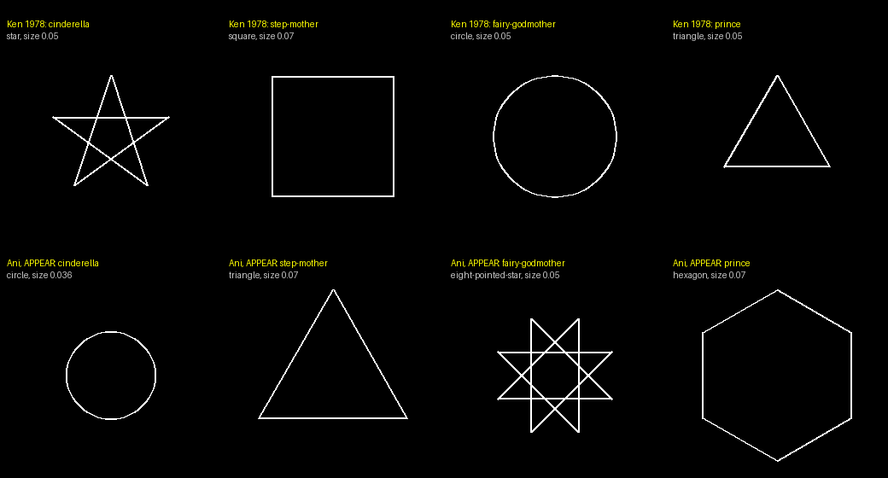
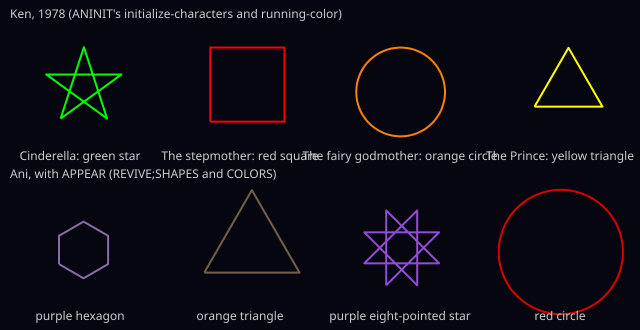
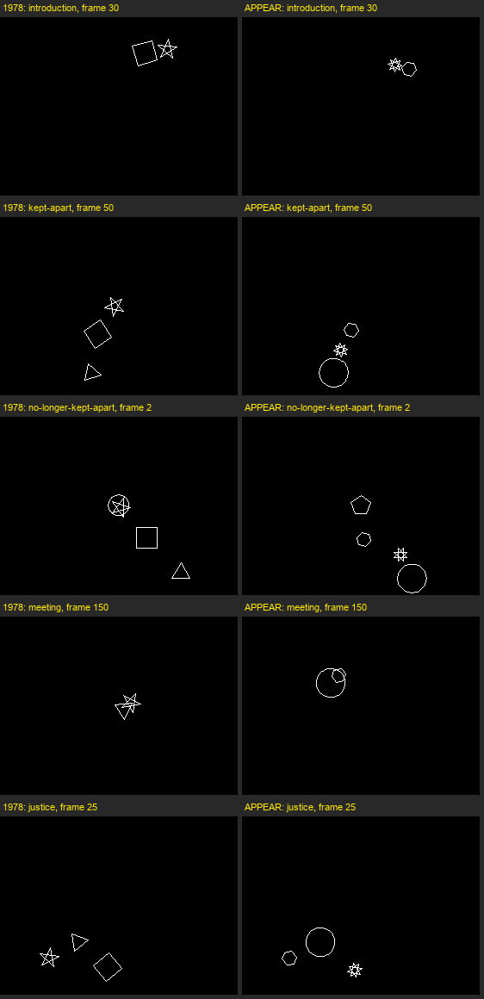

# Cinderella with APPEAR: the looks Ani chose, and what changed from 1978

These are the files Ken's Cinderella makes when Ani chooses her characters' sizes, shapes and colors, and changes their looks during a scene (APPEAR, stages 2 and 5 of [Phase 9](../../chapter-x/PLAN.md), "Items 1 and 2: appearances"), chained scene to scene as the film page makes them: at 4 frames a second here, and at 24, the page's default, in `24fps/`. With MEND as well, as the page makes it with the revival's extensions, both are the same, frame for frame, with no repair notes. `npm run test:ext` (`tools/check-ext.mjs`) checks that a run still makes those at 4 frames a second, and `npm run test:ext24` (`--fps 24`, about 15 minutes) those at 24; `--save` makes them again. `npm run test:appear` (`tools/check-appear.mjs`) checks the knowledge behind the looks against Ken's legitimacy rule and his decision 4 (below).

| File | What it is |
|---|---|
| `ken-cp.30` | Pass 1's answers, KEN;CP 30 |
| `appearances.json` | How Ani chose each look (`src/glassbox-pass1.js` `collectAppearances`): each choice, the sources of the suggestion that won it, and the value the look has as drawn; each look's hue and color, `[hue angle, saturation, value]`; and every piece of knowledge a look can come from, with its evidence |
| `pass1.json`, `pass1-choices.txt`, `pass1-reasons.txt` | Pass 1's glass box, as `tools/run-pass1.mjs --extensions appear --glass-box --save --save-all` writes it |
| `ken-<fn1>.<fn2>`, `ken1-<fn1>.mini`, `ken1-<fn1>.print` | Each scene's program, summary and printout (pass 2) |
| `<scene>.glass.json` | Each scene's glass box, with its `looks` and, where Ani changes a look during the scene, its `lookChanges` |
| `<scene>.film.json` | Each scene's film, with `looks`: who looks how from which frame, changes only, each with its `color` |
| `ken1-<movie>.posit` | Where each scene's filming left the characters |
| `24fps/` | The same for each scene, chained at 24 frames a second |
| `cast.png`, `frames.png` | Ken's cast beside Ani's, and one frame of each scene in 1978 beside the same frame with APPEAR (stage 2, in black and white: the shapes and sizes are as they were) |
| `colors.svg` | Ken's cast in his colors beside Ani's in hers (stage 5) |

## The looks

Each reason below is a source whose own suggestion was the value chosen, or, where Ani compromised, the two she met between.

| | Ken, 1978 | Ani, with APPEAR | Why |
|---|---|---|---|
| Cinderella | green star, size .05 | small hexagon, .036 | **Small:** she is shy (the revival's: a shy character keeps small and takes up little room), and the film is not to be flashy (Ken's comment in `(flashiness level)`, `glosug.41:39`: "size is also bigger is flashier"). **Smooth:** she is friendly (p. 161, "smooth is friendly") and graceful (from beautiful, `char.2:13-20`; the revival's: graceful movement is smooth movement, so a smooth outline). Shabby's ragged outline (the revival's, motivated by p. 166) was much less strongly suggested and set aside. **Moderately complex:** shy suggests a plain shape (the revival's) and her slow movement a complex one (the revival's dynamics source, motivated by p. 175), each weakly, and Ani compromised between them (`choose.198:499-505`). The polygon expert's one shape for smooth and moderately complex is the hexagon. |
| The stepmother | red square, .07 | large triangle, .07 | **Large:** she is strong (Ken's knowledge, p. 238: a large shape for a character "supposed to be a strong friendly ally"), and she dominates Cinderella (`relate.22:63`, "even more typical would be size"; p. 157, "be larger than the other"); the film's flashiness asked for small and was much less strongly suggested. **Jagged:** she is mean (the revival's: sharp, spiky outlines read as hostile), and she is to look different from Cinderella and the Prince, who are smooth (CSUMRY's uniqueness summaries; p. 94, a unique character should "move (or appear) differently"). **Simple:** she is to look different from the fairy godmother (complex) and Cinderella (moderately complex) (p. 94). The polygon expert's one shape for jagged and simple is the triangle. |
| The fairy godmother | orange circle, .05 | eight-pointed star, .05 | **Medium:** she is to look different from Cinderella (small) and the Prince (large) (p. 94); strong (p. 238) argued for large, and Ani combined it into the middle. **Not smooth** ("not low"): she is to look different from Cinderella and the Prince, who are both smooth (p. 94); drawn jagged, one of the two values that leaves. **Complex:** she is magical (the revival's: magic sparkles, a shape with many points), and she is to look different from Cinderella (moderately complex) (p. 94). For "not smooth and complex" the star expert offered the eight-pointed and the ten-pointed star; the first, the more stereotyped, was taken, since the film's originality is low. |
| The Prince | yellow triangle, .05 | large circle, .07 | **Large:** he is strong (in his physical description; p. 238), and he is to look different from Cinderella, who is small (p. 94). **Smooth:** he is graceful (from beautiful; the revival's) and his paths are smooth (the revival's dynamics source). **Simple:** he moves fast (the revival's: detail is lost in quick movement, motivated by p. 175), the film's variety suggested simple too (`glosug.41:43-55`), and he is to look different from the fairy godmother (complex) (p. 94). |

No two characters were drawn alike, so no choice was made again to tell two apart (`appearances.json`, `findings` is empty), and no expert overrode a choice (each element's `drawn` is its `value`, but for the fairy godmother's "not smooth", drawn jagged). Two of Ani's looks are Ken's. The stepmother is large, as he drew her, from his own knowledge: strong (p. 238), dominates (`relate.22:63`) and her uniqueness (p. 94). The fairy godmother is medium-sized, his .05, which three of his four have, so it sets no one apart. No piece of the revival's knowledge reproduces one of Ken's looks (below).

Before the review of 10 October Ani drew Cinderella as a small circle and the Prince as a large hexagon. The film's complexity no longer suggests a shape's complexity (below), so Cinderella's complexity is now a compromise, moderate, and the Prince's simple. The sizes are as before, so every frame's positions and events are as before too; only the shapes drawn differ. (For a day, between the review and Ken's decision of 11 October, strong's large size was dropped as the revival's, and the stepmother was a small eight-pointed star.)

## The colors, and looks that change (stage 5)

"The aspects of an appearance are the size, color, line, texture, and shape of a character. The elements of the color, for example, are the intensity, hue, and saturation" (p. 163). So a character's color is three more of Ani's choices, made as the others are, after the 102: color-intensity and color-saturation, three-valued as size is (intensity with a relative element, as size has), and color-hue, one of six hues on a painter's wheel, yellow, orange, red, purple, blue and green, whose value description is the revival's semantic net of hues (`REVIVE;COLORS` `hue-net`; "a 'semantic net of colors'", p. 240). Each look's color is `[hue angle, saturation, value]`, in the hue-intensity-saturation space p. 163's footnote calls "conceptually easier": each hue at the angle of the TV's color of that name (`(plist 'purple)` is `(BLUE 511 GREEN 0 RED 256)`, 270 degrees), a saturation .35, .65 or 1.0, an intensity .45, .65 or .85. Ken's colors were the TV's own, at its full intensity and saturation; Ani's bright is .85, short of that, so that joy can still brighten a bright character, and her dark is .45, not black, since the film is shown on a black screen.

| | Ken, 1978 (`running-color`, `aninit.65:83-87`) | Ani, with APPEAR | Why |
|---|---|---|---|
| Cinderella | green | a dull purple, neither bright nor dark (270, .35, .65) | **Dull:** she is shabby (the revival's: a shabby character's clothes are faded and dirty, so muddy, dull colors, p. 225's words), and the film is not to be flashy (Ken's comment in `(flashiness level)`, `glosug.41:40`: "color is many and bright is flashier"); beautiful's clear colors (the revival's, from p. 225's "bright and harmonious colors are typically more pleasant") were set aside as not compatible with those. **Neither bright nor dark:** she is good, the opposite of evil, so the opposite of evil's dark colors, bright (Ken's: p. 161, "bad guys wear black", through his net's opposites), and the film is not to be flashy, dark; Ani compromised between them, as she does two speeds that conflict (`choose.198:522-539`). **Purple:** nothing in her description suggests a hue, and of the six, none taken yet, the film's medium variety took the one in the middle of the list (`glosug.41:61-72`). |
| The stepmother | red | a dark, dull orange (30, .35, .45) | **Dark:** she is evil (Ken's: p. 161, "bad guys wear black"), and she is to differ in brightness from Cinderella and the fairy godmother (her relative choice points with them, different-from, from Ken's comparison and uniqueness summaries, p. 94), which evil's dark agrees with. **Dull:** she is ugly, the opposite of beautiful (the revival's clear colors, reversed through Ken's net), and the film is not flashy (Ken's comment). **Orange:** nothing suggests a hue, and the film's variety took the middle of those least used. On the black screen she is the darkest of the four, a brownish orange. |
| The fairy godmother | orange | a bright purple of middling saturation (270, .65, .85) | **Bright:** she is good and kind, both opposites of evil (Ken's, p. 161, reversed). **Middling saturation:** she is pretty (the revival's clear colors, from p. 225), and the film is not flashy (Ken's comment); equally strong, Ani compromised between them. **Purple:** she is magical (the revival's: purple is the color picture books give magic, the robes of wizards and fairies), and the film's variety agreed. |
| The Prince | yellow | a bright, clear red (0, 1.0, .85) | **Bright:** he is good (Ken's, p. 161, reversed), and he is to differ in brightness from Cinderella and the stepmother (his relative choice points, different-from, from Ken's summaries, p. 94), which bright agrees with; the film's lack of flashiness was much less strongly suggested and set aside. **Clear:** he is beautiful (the revival's, from p. 225), much more strongly suggested than the film's dullness. **Red:** the film's variety took the middle of the hues least used. |

None of Ani's hues is Ken's: of all four, only the fairy godmother's comes from a word (magical's purple, the revival's); the other three are the film's variety, which picks by the order of the hues on Ani's list where nothing else speaks. Listed from red, as a wheel is usually read, the list gave Cinderella green, the stepmother red and the Prince yellow, Ken's three colors, an accident of where the list starts; but the list is the revival's, so Ken's decision 4 drops that order (below). Two characters are purple, Cinderella and the fairy godmother: Ken's medium variety takes "the middle-most chosen" value, not the least used (that is high variety's), and nothing tells them apart in color; their shapes and sizes already do.

**Joy brightens.** "A suggestion for how to establish that a character is very happy is that the intensity of the colors of the character be increased" (p. 166). So each of Ken's joys also suggests a change of its character's color intensity (`REVIVE;ALTER`, a `look-change:`, a display method as Ken's `change:` is), by the joy's own amount at its speed, as each of Ken's changes for joy is made (`emote.9:11-36`); a sad character, a negative joy, dims. That the thesis's example reaches every level of joy, and sadness, is the revival's. The look change is made beside Ken's four changes of the same task by the same amount at the same speed (its activity level, speed, rhythmic level and acceleration), and its estimate is theirs (Ken's `estimate-time-for-change-by`), so the task takes as long as in 1978 (CHOMET takes the longest of a task's methods, `chomet.123:95-129`), and in Director it takes as many ticks as his change of speed (`dichar.103:102-121`), so no subscene ends later: the films' frames and events are stage 2's exactly. In Cinderella's five scenes, at 4 frames a second:

| Scene | Feeling (`cindy.46`) | What Director does to the color (`film.looks`) |
|---|---|---|
| Introduction | Cinderella and the stepmother, joy (positive low) | each brightens by an eighth at once, on frame 1: Cinderella .65 to .73, the stepmother .45 to .51. Ken's Director makes a change at low speed quicker, not slower (it multiplies his ticks-to-grow-e by the speed's weight, `dichar.103:105-109`, where DISPLY's estimate divides by it, the inversion SLIPS may correct), and a change by 1.125 at low speed takes one tick, for his changes of joy too |
| Kept Apart | Cinderella, joy (negative high); the stepmother, joy (positive medium) | in the third subscene, from frame 61: Cinderella dims by a third, .65 to the darkest a character is drawn, .45, by frame 75; the stepmother brightens by a quarter, .45 to .56, by frame 64 |
| Meeting | Cinderella and the Prince, joy (positive high) | from frame 172, Cinderella .65 to .70 and the Prince .85 to .92, when the film stops at frame 174: the joy's subscene starts at frame 171 and the scene ends with the subscene before it, which ends at 173, as in 1978, where joy's changes of speed are cut short the same way |
| Justice | the stepmother, joy (negative high) | nothing: she is as dark as a character is drawn already |

In black and white none of this shows; the film page paints it in color mode. The glass box of each scene lists its look changes (`lookChanges`: the task, the feeling, the method and what Director does), and `film.looks` has each character's color from frame to frame.

## Ken's looks and the revival's knowledge

Ken's decision of 9 October (`reports/chapter-x/PLAN.md`, "Decisions" 4): the revival may add knowledge the thesis doesn't state, labeled the revival's with its reason, and any entry that reproduces his 1978 looks is dropped; that is, any of the revival's own entries, since his own knowledge may agree with his 1978 looks (his decision of 11 October, "Decisions" 6). His legitimacy rule is p. 189's: to change Ani only by adding obvious information that was lacking, never "arranging for Ani to do what I want without improving the reasoning". `tools/check-appear.mjs` applies it:

1. Ken's .05 is his medium: "I choose the following shapes and sizes for them" (p. 17).
2. Each piece of knowledge is followed to each character and element it reaches, and each is judged on its own: is the value it suggests Ken's, and did that value set the character apart in his drawing? A piece that gives back Ken's value wherever it reaches, setting someone apart, would draw his cast (as "evil suggests red" would have), and fails. A piece of the revival's that gives one character a value of Ken's that set it apart is flagged. Ken's colors are his hues: they were the TV's own colors, each at its full intensity and saturation, so only their hues set his characters apart, and every one of them does.
3. Two pieces of the revival's that together give a character Ken's shape (one its jaggedness, the other its complexity) are flagged.
4. Pass 1 is run again, with only the revival's knowledge (Ken's own left out), and without each piece of the revival's that reaches one of Ken's characters, and each run's looks are set beside Ken's (a look of Ken's here is one that set the character apart: any of his four shapes, any of his four hues, or the stepmother's large size). A piece without which a look of Ken's in Ani's result goes away brings that look about: decision 4 drops it. A look of Ken's that only the revival's knowledge gives is flagged.

Every flag needs a decision, kept with its reason in the tool's `REVIEWED`; one without a decision fails the check, and so does a decision for a flag no longer raised. The decisions:

- **Strong suggests large is Ken's** (his decision of 11 October, `reports/chapter-x/PLAN.md`, "Decisions" 6), from p. 238: an improved Ani might give a very pleasant friendly character a large pointed shape, "chosen because the character is supposed to be a strong friendly ally". The thesis gives it for a strong friendly ally; the entry gives it to any strong character. It is what makes Ani draw the stepmother large, as Ken drew her (without it, her dominating Cinderella loses to her looking different from the Prince, and she is small); decision 4 drops only the revival's own entries that give back his looks, and his own knowledge may agree with them. The review of 10 October had relabeled it the revival's generalization, and so dropped it, for a day. "Physically strong suggests large", the revival's, reaches none of Ken's characters.
- **The two dynamics rules: kept.** A character's outline follows its paths (shape-jaggedness after path-jaggedness), and a fast character is drawn simply (shape-complexity opposite to speed), both the revival's, motivated by p. 175. The stepmother's paths are of medium jaggedness and she is fast, so together they give her Ken's square, where nothing else speaks: with only the revival's knowledge, Ani draws her as a square. They are kept because they reach all four and agree with Ken only for her (and the speed rule for the Prince, whose triangle is simple too): Cinderella's medium paths, the fairy godmother's jagged ones and the Prince's smooth ones disagree with his star, circle and triangle. In Ani's film, which has Ken's own knowledge in it, she is not a square, and no look of Ken's in it needs either rule.
- **Shabby suggests jagged** is now the revival's, motivated by p. 166, where the script changes Cinderella "from being shabby and ragged": that says what shabby is, not how Ani is to draw it. It gives Cinderella the jaggedness of Ken's star, which the Prince's triangle shares, so it set her apart in nothing, and in her film it loses to friendly and graceful.
- **The film's complexity no longer suggests a shape's complexity.** It was cited to p. 164, but p. 164 has the experts' offers "selected between on the basis of the desired levels of variety, simplicity, originality", which the shape experts' `select-shape` does; a suggestion for shape-complexity as well counted the film's complexity twice.
- **Obviousness** is the revival's: p. 165 says how many aspects a film should use ("if subtle, then only a few"), and reading that as a film that is not obvious leaving a look at medium, which says nothing, is ours. Ken's Cinderella is obvious, so it suggests nothing here.
- **Mean suggests jagged** has its reason on its own, as a convention of the kind p. 161 says appearances rest on, no longer as "the other side of smooth is friendly" (friendly's opposite in Ken's net is unfriendly, which gets jagged from it).
- **The colors (stage 5).** Evil's dark colors are Ken's, p. 161's "bad guys wear black", a darkness, an intensity, not a hue, and his comment "color is many and bright is flashier" (`glosug.41:40`) makes a film that is not flashy darker and duller; beautiful's and pretty's clear colors and shabby's dull ones are the revival's, motivated by p. 225 ("bright and harmonious colors are typically more pleasant than muddy, dull, or clashing colors"), which says what pleases, not who wears what; magical's purple is the revival's, the only hue any word suggests. p. 161's "green is jealous" is Ken's too, but no word of Ani's is jealous. None of these reaches one of Ken's hues: Ken's intensities and saturations set no one apart, and magical's purple is not the fairy godmother's orange.
- **The order of the hues: Itten's, not from red.** Where nothing else suggests a hue, the film's variety does, by Ken's pick-value-with-variety: of the values least used, for a film of medium variety, the one in the middle of the list (`glosug.41:61-72`; `middle-element`, the nth of half the length, a KEN1 reconstruction). The list is the revival's. Read from red (red, orange, yellow, green, blue, purple), as a wheel usually is, it gave Cinderella green, the stepmother red and the Prince yellow: three of Ken's four colors, from no knowledge at all. Ken's decision 4 drops the revival's own arrangements that give back his looks, so the list is read round the wheel as Johannes Itten drew it, from yellow at the top (yellow, orange, red, purple, blue, green: the same wheel, the same neighbors and complements), and gives back none of his colors. Read from purple it would have given Cinderella yellow and the Prince green, Ken's colors swapped; from red with the primaries first, the stepmother red. This is for Ken to decide (below).
- **Joy brightens** is Ken's own example (p. 166) for a very happy character; that it reaches every level of joy, by the joy's amount, and a sad character dims, is the revival's, as each of Ken's changes for joy is made by the joy's amount (`emote.9:11-36`). It changes no look of Ken's: his characters never changed color.

What the runs drew, where any of Ken's looks came back:

| Knowledge | Cinderella | The stepmother | The fairy godmother | The Prince |
|---|---|---|---|---|
| All of it (Ani's film) | small purple hexagon | **large** orange triangle | medium purple eight-pointed star | large red circle |
| Only the revival's | small purple pentagon | medium orange **square** | medium purple eight-pointed star | large red circle |

Without each of the revival's pieces in turn, the stepmother stays large, by Ken's knowledge, and no one is drawn as one of Ken's shapes or in one of his hues: no piece of the revival's brings one of his looks about. Without magical's purple, the fairy godmother would be orange, Ken's color, by the film's variety, and the stepmother yellow: with it, neither is.

## Two characters Ani still chooses alike

Two characters drawn alike have the least justified of their shape choices made again, with a different-from suggestion between them (p. 94, "choosing divergent values for one or two elements to help the viewer distinguish the two characters"; p. 164, "the least justified value of the elements ... can be redetermined"), so the choice points and the drawing agree. Two that Ani still chooses alike, as she does twins whose descriptions are the same (her comparisons then tell her strongly that they look the same), are kept apart by the shape experts as a last resort. Since the review:

- The experts relax the second twin's shape choices, the least justified first, until it is drawn as a shape that differs from the first's on **both** elements, relaxing again if need be ("the 'constraint relaxation' ... methods can be applied iteratively", p. 164). Before, they relaxed one and took the first shape not taken: a hexagon beside a pentagon of the same size, which differ by one step on one element and are told apart hardly better than two pentagons.
- What they overrode is in the data: each element in `appearances.json` has `drawn`, the value the look has as drawn, and, if the experts overrode the choice, `overriddenBy`, the choice point's `(overridden-by: shape-experts drawn star because (drawn-alike-with dum))`; `tools/run-story.mjs` prints both on its looks line ("shape-jaggedness medium from ..., drawn high (overridden-by: ...)").
- Twins are kept apart even if they never share a scene: a viewer knows a character from scene to scene by how it looks, and two drawn the same in different scenes would be taken for one.

In the reviewer's story of Tweedledum and Tweedledee, ugly, stubborn and selfish, who hate each other, Ani chooses both a large square, and each of their four shape choices, chosen again to tell them apart, comes back the same. The experts draw Tweedledee as a star, jagged and moderately complex, overriding both of his shape choices; Tweedledum stays a square, as Ani chose him. Before, Tweedledum was drawn a pentagon and Tweedledee a hexagon. In the reviewer's story of seven, every one is now drawn as a shape of its own: of the two twins, kind and friendly, one is a square, as Ani chose them both, and the other a star.

## What changed from 1978, and why

### Pass 1

- `ken-cp.30` has CP 29's 102 choices, with the same values, in the same order. Ani makes them all before she chooses any look (`(choose-appearances)` runs after `(z)`), so no look can move them.
- It has 48 more choices: 24 absolute ones (color-intensity, color-saturation, color-hue, size, shape-jaggedness and shape-complexity for each of the four, their parent `appearance-choice-point`) and 24 relative ones (relative-size, relative-shape-jaggedness, relative-shape-complexity and relative-color-intensity between pairs). `save-answers` lists relative choice points newest first, so these 24 come at the top of the file, and the 24 absolute ones after Ken's 48.
- It ends with each character's look, `(define (appearance-of cinderella) appearance (set your shape to hexagon) ... (set your hue to purple) (set your look-color to (270.0 0.35 0.65)))`, which pass 2 reads.
- Take these 52 forms out and the file is `reports/pass1-choices.txt`, byte for byte.

### Pass 2

- **Starting from where the 1978 film left the characters** (`reports/pass2`'s POSIT files), each scene's program is 1978's once the four `(ask ... take look (look: ... look-color (270.0 0.35 0.65)))` forms at its end are taken off, and the look changes joy's tasks add (each `(look-change: ...)` method, and the `(gradually change look by ...)` it adds to its subscene's changes for the character), and what is taken off the end is exactly those forms, as the Lisp that wrote the program prints them. Its summary, printout and glass box (without its `looks` and `lookChanges`, and without the look changes) are also byte for byte 1978's. `tools/check-ext.mjs` checks all of this. So the look changes move no method, time or place: each joy task takes as long as in 1978, since a look change's estimate is that of the joy's change of speed beside it. The looks don't reach Ani's planning: pass 2 reads a size only as the `ani-size` of a character's vicinity, which Ani's own characters don't have (`interf.149:131-135`, "for now they don't change").
- **Chained, as here:**
  - The Introduction's and Kept Apart's programs are 1978's, apart from the looks and the look changes.
  - No Longer Kept Apart's, the Meeting's and Justice's programs differ only in where the characters start. These are the locations in their first subscene (and the Meeting's second), which RUN reads from the POSIT file that the previous scene's filming wrote (`run.65:52-53`).
  - Every summary (MINI) file is 1978's, apart from the look changes, which the four scenes with joy list among their joy tasks' methods.
  - The printouts and glass boxes differ by those same positions, and by the distances between characters that are measured from them. In Kept Apart that is a single one, from Cinderella to the Prince, and it doesn't reach the program.

### Filming

| Scene | 1978 frames | With APPEAR | At 24 frames a second: 1978 | With APPEAR |
|---|---|---|---|---|
| Introduction | 192 | 193 | 917 | 918 |
| Kept Apart | 116 | 116 | 701 | 701 |
| No Longer Kept Apart | 17 | 19 | 113 | 112 |
| Meeting | 179 | 175 | 1051 | 1038 |
| Justice | 84 | 92 | 458 | 418 |

Director's collisions use each character's size:
- Two characters are in contact when they are closer than the sum of their sizes (`are-they-colliding`, `dichar.103:348-352`).
- A walker stops for, or goes round, someone at its destination by the same sum (`dichar.103:285-323`, `355-358`).
- A hit goes in to 0.8 of the two sizes (`dichar.103:509-527`).
- Whether a character is off the stage depends on its size (`dichar.103:41-49`).

Ani's sizes are .036 for Cinderella (.05 in 1978), .07 for the stepmother (.07), .07 for the Prince (.05) and .05 for the fairy godmother (.05). So, at 4 frames a second:

- **Introduction (one frame longer).** The stepmother pushes the smaller Cinderella. The push's moving together ends at frame 69 (70 in 1978), and her moving away at 104 (102). The first subscene ends at 108 (106), and everything after it is two frames later. The Prince gets on stage and walks to accompany Cinderella. His walk ends at 158 (157), and the scene at 191 (190).
- **Kept Apart (no change in length).** Each round of the guard's chase ends when she comes in contact, so the rounds shift by one to three frames. The scene ends where 1978's ends. Its length is set by the subscenes' running times, which Ani planned as in 1978.
- **No Longer Kept Apart (two frames longer).** Cinderella starts where Kept Apart left her, which is not where 1978 left her. The fairy godmother gets on stage and walks to her, reaching her a frame later. They accompany each other to frame 17 (15).
- **Meeting (four frames shorter).** The Prince walks to Cinderella until they touch. With his larger size and her smaller one they touch at .106 of the screen apart, not .10, so they meet at frame 89 (93). Every later event is four frames earlier.
- **Justice (eight frames longer).** The Prince and Cinderella start where the Meeting left them, facing other ways, and repeatedly come in contact. The last of those walks to contact ends at frame 89 (81).

At 24 frames a second the same sizes make the same kinds of difference. With MEND as well the films are the same at both rates, frame for frame, and MEND leaves no note. (For the day that strong's large size was dropped, the stepmother was small, and at 24 frames a second the Meeting never ended with APPEAR alone: Cinderella, going to meet the Prince, waited for someone in her way to move and never set off, a walk MEND's M12 stops.)

Two things in the pictures follow from Ken's Director, not from APPEAR:
- Characters walking together overlap. In 1978 the Prince's triangle and Cinderella's star crossed; now Cinderella's small hexagon sits inside the Prince's large circle while they "get it on".
- Every shape turns with its character's heading, so the stepmother's triangle points the way she goes, at Cinderella when she pushes and chases her.

Director's own color filming (`tools/run-scene.mjs --color`, ANINIT's `running-color`) isn't supported with APPEAR. Its many-polys parts are copies made before the program loads, so they would keep Ken's shapes, and it draws in the TV's colors, sixteen at a time (p. 259), where Ani's change a little each tick. Director keeps each character's color as its `look-color` and never draws with it; the filming records it in `film.looks`, and the film page paints it in color mode. Until stage 5 the page drew each character of a film with Ani's looks in its 1978 color (Ken's decision of 11 October, "Decisions" 7); now Ani chooses the colors.

## From stage 2 to stage 5: each difference in Cinderella's films, and why

Stage 5 adds the colors and the look changes. Everything stage 2 made is as it was, but for these, at 4 frames a second and at 24, and with MEND as well:

- **Pass 1 (`ken-cp.30`, `pass1.json`, `pass1-choices.txt`, `pass1-reasons.txt`, `appearances.json`).** 18 more choices (12 absolute and 6 relative: each character's intensity, saturation and hue, and relative intensity between pairs), and each character's hue and color at the end of its `(appearance-of ...)`. Every size and shape choice is as it was, line for line and in the same order: the colors are the oldest of the appearance elements, so each character's node takes its size and shape choices first, as before. `appearances.json` has each look's `hue` and `color`, the three color elements, the experts' `(colored: ...)` and the color knowledge.
- **Pass 2 (each scene's program, MINI, PRINT and glass box).** Each take-look form has the character's `look-color`. In the four scenes with joy, each joy task has one more method, `(look-change: element (cinderella color-intensity) amount (negative high) speed high)`, after Ken's, and its subscene one more change for the character, `(gradually change look by 0.66666667 factor for color-intensity at high speed)`, first in the list, where `add` puts the newest; the printout and the glass box show the method's suggestion and its time estimate, and the glass box lists it under `lookChanges`. No Longer Kept Apart has no joy and changes only by its look-colors.
- **Filming (`<scene>.film.json`, the POSIT files).** Every frame and event is stage 2's, at 4 frames a second and at 24 (the duration guard, below). `film.looks` has each character's `color` from frame 0, and an entry each time a color changes: one at frame 1 for each joy in the Introduction, fifteen and four in Kept Apart's third subscene, three each in the Meeting's last frames, none in Justice (see "Joy brightens", above). The POSIT files are as they were.

**The duration guard.** `tools/check-ext.mjs` films Kept Apart twice, as its program is and with its look changes taken out, from 1978's positions and in the chained film at the rate checked: the same frames and events, and the joy subscene ends on the same frame (114 at 4 frames a second). At 4 frames a second it does the same for the first scene of the stress story pushed-around (Ken's tortoise and hare as a model wrote it), where the very happy hare moves alone at first. That second guard found what Kept Apart could not: Director's universe ticks its actors each tick in the order they first planned something the tick before (`REVIVE;BRIDGE`), and the look change, first among the hare's changes, at first planned its steps on the hare itself, before Ken's first change planned on the hare's special dynamics. The hare then moved before its special dynamics grew, every tick, and the Introduction ran 497 frames, not 586. A look change is now carried from tick to tick by the character's special dynamics, as Ken's own change is (`dichar.103:112-117`; `REVIVE;LOOKS` `look-change-carrier`), and plans where Ken's first change would have: the hare's film is as it was, as is every stress story's.

## Decisions for Ken (stage 5)

1. **The order of the hues on Ani's list.** Where nothing suggests a hue, the film's variety picks one by the list's order (`glosug.41:61-72`). Read from red, the list gave your Cinderella, stepmother and Prince your own green, red and yellow; the revival reads it round Itten's wheel from yellow, which gives back none, under your decision 4. Another order would give other hues; say if you would rather the colors no word suggests came from somewhere else (the relationships, say: enemies in complementary hues), or none at all, drawn grey.
2. **Joy for every level, and sadness.** p. 166 gives the brightening for a very happy character; the revival makes it every joy's, by its amount, and a negative joy dims. Say if only (joy (positive high)) should change a look.
3. **High intensity .85, not 1.0, and a floor of .45.** So that joy can still brighten a bright character; and a dark one, the evil stepmother, can't be darkened by sadness (Justice shows nothing). Say if a dark character should be allowed darker than .45 when sad.
4. **Look changes ride on the special dynamics.** In Director a look change is carried tick by tick by the character's special dynamics, as your own `gradually change` is, not by the character, so that it changes nothing about when the characters move (the guard above). That is a Director detail of the revival's; say if it should be done otherwise.
5. **Shape in-betweens turn beside the shape.** The design had KEN1;INTER interpolate calls that include the center-offset turn; INTER cannot pair a call that starts with a turn with one that starts with a move, so the turn is in-betweened beside the shape, through OBJECT's center-offset, and ends exactly as your center-offset draws it. A change with more than 400 moves (a circle into a star) is made at once.
6. **No size change for joy.** The design offered a small size change for (positive high) and (negative high), marked as the revival's. It is left out: a size changes Director's collisions, so joy would move your film's events; p. 166 names only the colors' intensity.
