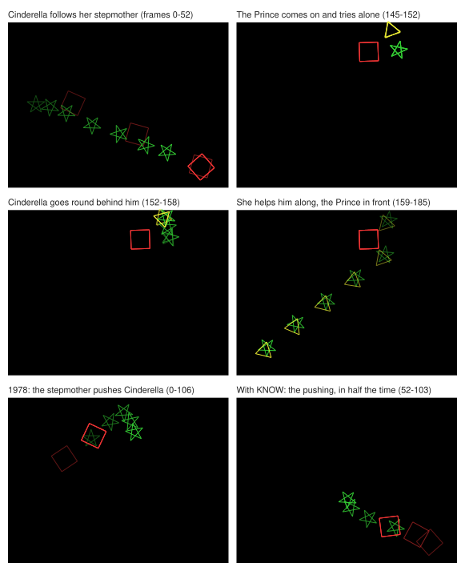

# Cinderella with KNOW: the knowledge you could have added, and what it changes

KNOW (stage 4 of [Phase 9](../../chapter-x/PLAN.md), "Item 4, part 2: KNOW") adds knowledge your Ani didn't have: words for characters, ways of showing relationships, three display methods, and feelings. Each piece is in the idiom of the file of yours it extends, read in after that file loads, and each has its evidence or the revival's reason (your decision 4 of 9 October: the revival may add knowledge the thesis doesn't state, labeled as the revival's, with its reason). The files are `src/director/revive/know.lisp` (REVIVE;KNOW: what they share, and the rule for judging each piece) and its five parts, KNOWDS, KNOWRL, KNOWCV, KNOWDI and KNOWEM. KNOW needs MEND: its display methods bring on a character who is off the stage with MEND6's step, and its feelings are combined with joy by MEND7's repair of COSUG's combine.

These are the files your Cinderella makes with KNOW, chained scene to scene as the film page makes them: at 4 frames a second here, and at 24 in `24fps/`. `npm run test:know` (`tools/check-ext.mjs --extensions know`) checks that a run still makes them at 4, and `npm run test:know24` at 24 (about 25 minutes); `--save` makes them again. `npm test` runs `test/know.test.js`, which checks the pieces one by one and the rule that keeps pass 1 at CP 29, and `test/story-names.test.js` (below). `npm run test:stress` makes six stories that use KNOW (`test/stories/stress/know-*.lisp`), and every other stress story, with the extensions the page's switch turns on.

| File | What it is |
|---|---|
| `ken-<fn1>.<fn2>`, `ken1-<fn1>.mini`, `ken1-<fn1>.print` | Each scene's program, summary and printout (pass 2), chained |
| `<scene>.glass.json` | Each scene's glass box |
| `<scene>.film.json` | Each scene's film |
| `ken1-<movie>.posit` | Where each scene's filming left the characters |
| `from-1978/` | The Introduction's and Kept Apart's pass 2, each planned from where your 1978 film left the characters, to set beside `reports/pass2` |
| `24fps/` | The chained film at 24 frames a second |
| `frames.svg` | The Introduction's new activities, each drawn at several frames |
| `trials.md` | The model's fifteen stories, and a reviewer's, with KNOW |

## The knowledge

Every piece below is the revival's unless it says it is yours. Its file and line, and the reason, are in `tools/know-index.mjs`'s index (the page's `DATA.know`), which the glass box will use to mark each suggestion that comes from it.

**Words** (KNOWDS, written as DSCRP). One word of each pair has the suggestions, and its opposite takes them, reversed, through your opposite links, as brazen takes shy's.

| Word | Kind | Suggests | Shows itself by | Why |
|---|---|---|---|---|
| gentle; rough | personality | slow, low acceleration, smooth paths | | Michotte: "slow motion conveyed gentleness", rapid movement violence (thesis p. 159, L4189-4190) |
| nervous; calm | personality | jagged paths, high acceleration, not deliberate | | Michotte: "sudden and repeated variations of direction, or even merely of speed" give "nervousness" (p. 103, L2823-2825) |
| cheerful; gloomy | personality | high activity, rhythmic, curved paths | | your joy, as a lasting disposition (emote.9:11-48) |
| clever | personality | deliberate, direct paths | | named as a word that could be added (p. 19, L660-662) |
| brave; cowardly | personality | drawn towards enemies, deliberate | brave chases its enemy; cowardly avoids it | as mean chases (dscrp.17:252-259); Michotte: "as though B was afraid when A approached, and ran off" (p. 158, L4157) |
| curious | personality | strongly drawn to strangers | meets a stranger (MEND5's move-to) | the other way from shy's avoidance (dscrp.17:66-74) |
| playful | personality | rhythmic, curved paths, active | | lively, bouncy and roundabout |
| old; young | physical | slow, low acceleration, less active | | you let a physical word decide movement: beautiful makes graceful (char.2:13-20) |
| slow; quick | movement | slow, strongly | | Ani had no word for a slow mover, and your hard-working and determined say "not slow" (dscrp.17:78, 241), so a slow, plodding character came out fast, as the film page's tortoise did |
| timid, wicked, cruel | personality | nothing of their own: each is a neighbor of shy, evil or mean | what their neighbor shows itself by (below) | your similar links, "indirect sources of suggestions" (p. 83, L2342-2344) |

**Relationships** (KNOWRL, written as RELATE). None suggests anything for the relative dynamics, so none can move a pass-1 choice.

| Word | Shows itself by | Why |
|---|---|---|
| is-obedient-to (yours) | following, medium | "Ani has no idea how to establish that Cinderella is obedient towards ... her stepmother" (p. 65, L1855-1857) |
| is-helpful-towards (yours) | helping, medium | "helps" could be added (p. 19) |
| is-protective-to (yours) | accompanying, low | your decision 10 |
| is-grateful-to (yours) | accompanying, low | your decision 10 |
| is-intolerant-of (yours) | avoiding, medium, best when it doesn't dominate the other | as hates avoids (relate.22:42-45); your decision 10 |
| is-polite-to, is-impolite-to, is-tolerant-of (yours) | nothing | your decision 10: Ani could show them only by gestures she doesn't have, and nothing else would be "obvious information that was lacking" (p. 189) |
| likes (PREREQ's prerequisite) | accompanying, low | likes counts loves (prereq.19:115-116), which shows itself by accompanying (relate.22:28-32); liking is less |
| dislikes | avoiding, medium, best when it doesn't dominate the other; a neighbor of hates | PREREQ already reads dislikes as the other side of likes (prereq.19:117-118); as hates avoids (relate.22:42-45) |
| fears | avoiding, high | named as a word that could be added (p. 19); Michotte (p. 158) |
| is-protective-of (CINDY's, which RELATE doesn't know) | what is-protective-to shows itself by, as its neighbor | your decision 10, SLIPS' S4 idea as knowledge. Defined as a relationship word of no type, as CHAR made it in 1978 (char.2:162-168), so CINDY's description of it is as it was |

**Ways of showing** (KNOWCV, written as CONVEY; KNOWDI, written as DISPLY). Each display method is made only of DISPLY's and PLACE's parts, places the two characters as yours do, brings on the other one if it starts off the stage (MEND6), and counts that walk in its time estimate. None names a prerequisite, as goes-to-and-accompanys, chases-to and move-to-and-hits name none: can-move has no status any method can read, and asking it loads PREREQ (below). Every walk that ends before the method does goes to a place fixed as it sets off, so that it leaves its walker at a place INTERF can measure from (below).

| Verb | Display method | What it looks like | Why |
|---|---|---|---|
| helps (yours, with no way of showing: "for now don't have an suggestions as to how to convey this", convey.64:127) | helps-along | the one helped sets off slowly on its own, a small part of the way (trying-alone), and for a second and a half no one helps it; then the helper goes round behind it (goes-behind-to-help, to your a-small-distance-away-from, interf.149:395-402), comes up against it (comes-in-contact-to-help), and with no pause they go on together, the helper behind, at its pace (helping-along) | Michotte's launching, which your pushing is made of: with no pause "observers perceived the first square as causing the other to move" (pp. 158-159, L4168-4178); the pushee moved with the pusher's dynamics (disply.311:289-315). With the helper close by and setting off at once, it read as a push (L4174-4176) |
| avoids (yours, a kind of prevents, whose receiver asks for prevents by name, convey.64:167-181) | moves-away-from | the other comes a small part of the way towards it (other-approaches); half a second later it runs off the other way (moves-away), a quarter of the screen, as your chasee runs from its chaser (convey.64:102-111), regardless of anyone in its way, as your exit-by does | "as though B was afraid when A approached, and ran off" (p. 158, L4157) |
| follows (new, a kind of moves, as chases is) | follows-behind | the leader goes a good way off (leading); half a second later the follower sets off after it, moving as it does itself but no faster than nine tenths of the leader's pace, keeping behind, and closes up to it when it stops (following) | as a chaser sets off after its chasee, keeping its own dynamics (disply.311:48-96); the walk to contact as goes-to-to-accompany's (disply.311:204-213) |

kills is left out: Ani has no notion of a character leaving the story for good (nor of the resurrection your footnote has the fairy godmother perform, p. 99). gives, does, moves, takes, requests and refuses need things to give and take, which Ani doesn't have.

**Feelings** (KNOWEM, written as EMOTE). Each suggests changes as joy does, as large as the feeling and at its speed. A level is written as joy's, (pride (positive medium)): that is the one form to teach, since your joy takes only a signed level ((joy high) stops pass 2: `(second joy-level)` of an atom, emote.9:13-17). KNOW's feelings take a plain level too, as you wrote your pre-meeting scene, (anticipation high); that scene (cindy.46:119-125) is commented out and never ran. A negative level suggests nothing (a negative pride is shame, not pride reversed), and the feeling's task gets a note, `feeling-not-shown`.

| Feeling | Changes | Why |
|---|---|---|
| pride | path-jaggedness down, medium; deliberateness up, low | a proud character moves smoothly and deliberately; your Kept Apart makes the stepmother proud (cindy.46:72). It leaves speed alone (your decision 9, below) |
| anticipation | activity-level up, high; rhythmic-level up, medium; path-jaggedness up, low | your pre-meeting scene (cindy.46:121) |
| loneliness | speed down, medium; activity-level down, medium; path-length to long, low | your pre-meeting scene (cindy.46:124); your sad joy lengthens paths (emote.9:61-66) |
| fear | speed up, high; acceleration up, high; path-jaggedness up, medium | Michotte: nervousness, agitation (p. 103), running off (p. 158) |
| anger | speed up, high; acceleration up, high; path-curvature down, medium | Michotte: "Rapid movement gives the impression of "violence"" (p. 103) |

**Sharing with neighbors** (REVIVE;KNOW). "bad ... should get most from its neighbor" (dscrp.17:183). A word with no way of showing itself borrows each neighbor's, at the same strength, with the source `(neighbor-of word neighbor)`, as pass 1 borrows a neighbor's suggestions for how a character moves (cosug.215:84-88). This is narrower than pass 1's sharing, where every word's neighbors are a further source whether it has suggestions of its own or not: here a word borrows only if it has no way of its own. Your comment is about such a word; and a word that already shows itself would only put more convey tasks in competition for the few CHOMET keeps (chomet.123:474-490), changing what your knowledge chose (the stepmother's hates would gain dislikes' avoiding). So a timid character avoids a stranger as a shy one does, a cruel one chases or hurts its enemy as a mean one does, and CINDY's is-protective-of accompanies as is-protective-to does.

## Your legitimacy rule

"The only legitimate changes that can be made so that Ani makes choices more to my liking are to add obvious information that was lacking or was too inaccurate"; anything else "would constitute cheating" (p. 189). Nothing in KNOW removes or penalizes an option of yours, and nothing in it is there to make Cinderella come out one way: each piece is general knowledge about a word, a relationship, a way of showing or a feeling, and its reason says so. kills is left out for a reason about what Ani can represent, not to keep the stepmother from killing Cinderella.

## What changed from 1978, and why

### Pass 1: nothing

KEN;CP 30 is byte for byte what Ani as in 1978 writes (`reports/pass1-choices.txt`): CP 29's 102 choices, each in its place. The choice points and their reasons are those of `app/data/pass1.json`, and pass 1 leaves no repair note. That rests on a rule `test/know.test.js` checks in a running Lisp: none of KNOW's words with suggestions of its own for how a character moves is a neighbor or opposite of a word CINDY uses, and KNOW gives CINDY's words no such suggestions. Your DESCRIPTOR spreads each link to the neighbors' neighbors and the opposites' opposites (char.2:111-131), so the check is made on the links as they are after spreading: wicked, a neighbor of evil, is then an opposite of good and kind too, and timid an opposite of brazen and forward. The words linked to CINDY's are timid, wicked, cruel and dislikes, and is-protective-to, now CINDY's is-protective-of's neighbor; none has suggestions of its own. is-protective-of is KNOW's now, a relationship word of no type, as CHAR made it in 1978.

### Pass 2, from your 1978 positions

Each scene planned from where your 1978 film left the characters (`reports/pass2`'s POSIT files): No Longer Kept Apart's, the Meeting's and Justice's programs, summaries, printouts and glass boxes are byte for byte 1978's. KNOW changes two scenes.

**The Introduction** (`from-1978/`, the same as the chained run, since it is the first scene):

- **Cinderella follows her stepmother.** Your Introduction establishes her relationship to her stepmother, (and is-obedient-to is-tolerant-of). In 1978 neither word had a way of showing it, and Ani warned that she had "no idea how" (p. 65, L1855-1857; establish-task-6 is `cant-do` in `reports/pass2/introduction.glass.json`). Now is-obedient-to suggests following, so the task becomes a convey task, (follows cinderella step-mother), shown by follows-behind. Following comes first: the stepmother walks to a far corner, and Cinderella, coming on from the side, follows her at her own slow pace and reaches her well after she has stopped (frames 0 to 52). is-tolerant-of still has nothing to show it.
- **Cinderella helps the Prince.** Her friendly suggests helping a friend (dscrp.17:109-116), and friend-of finds the Prince, whom she loves. In 1978 Ani chose it and then had no way of showing helping, so she "canceled it" (p. 65, L1857-1859): convey-task-11 has no suggestion and is `cant-do`, with a subscene of no time. Now helping is shown by helps-along, in the fifth subscene (frames 145 to 186): the Prince comes on and sets off slowly on his own; a second and a half later Cinderella goes round behind him, and as she reaches him they go on together to the far corner, the Prince in front.
- **The Prince is brought on in her helping**, by MEND6's step, and the glass box has its note, `brought-on-stage`. In 1978 her accompanying him, which comes after, brought him on (goes-to-and-accompanys' getting-on-stage, disply.311:192-203); now he is on the stage already, and that step goes nowhere.
- **The scene's time is shared six ways, and the pushing is half as long.** Your SCENE gives each task in the sequence an equal share of the scene's 30 to 75 seconds (scene.9:333-344, 415-424): six tasks now, each 5 to 12.5 seconds, where five had 6 to 15. Your give-every-task-its-ideal-time-1 hands the first task of a sequence the parallel flag of the `(and ...)` it is in, and a task in parallel takes its whole ideal time, not a time within its share (chomet.123:76-116). In 1978 the first was the pushing, which so ran its ideal 24.4 seconds, five pushes. Now the first is the following, 12.8 seconds, and the pushing is held to its share, 12.5 seconds: its subscene is stretched by 0.51 (scene.9:159-197), and the stepmother pushes Cinderella four times, more quickly. The chasing, the hitting (ten hits, as in 1978) and the accompanying are as in 1978; the helping runs its whole share, 12.5 seconds.
- **The scene** is planned at 55.6 seconds (42.2 in 1978) and films in 225 frames (192).

The stepmother's convey methods are as in 1978. Her hates suggests avoiding, best when she doesn't dominate Cinderella (relate.22:42-45), and avoiding now has a way of being shown, but she dominates her, so Ani chooses pushing, as in 1978.

**Kept Apart** (`from-1978/`). Your scene makes the stepmother (and (joy (positive medium)) (pride (positive medium))) (cindy.46:70-72). In 1978 Ani knew only joy and passed over pride without a word (ask-if-exists, sugest.123:38). Now pride makes her paths a fifth less jagged, `(gradually change by 0.8 factor for path-jaggedness at medium speed)`, and her movements a quarter more deliberate, which Director doesn't read, as in 1978 (thesis L4853-4856). Her joy's changes, speeding her up among them, Cinderella's sadness, and the scene's times (29.75 seconds) are as in 1978. Filmed from your 1978 positions, the scene is 1978's, events and all, but for the stepmother's moves from frame 62, two frames after the feelings' subscene starts, which differ by at most a dot: she is still standing guard, and the guard's walks have the dynamics their own subscene made.

Your decision 9. As first written, pride also slowed her. Her joy speeds her up, so the two changes to her speed had different signs, and your CHOMET makes neither: it takes only suggestions, rejecting conflicting changes as a stopgap ("hopefully all conflicting ones are so noted for now rather than resolving them I'll reject", chomet.123:464), where pass 1's heuristics would have picked the stronger (pp. 108-109). So pride only cancelled the speeding up her joy gave her in 1978. Now pride leaves speed alone.

### The film, chained

| Scene | 1978 frames | With KNOW | At 24 frames a second: 1978 | With KNOW |
|---|---|---|---|---|
| Introduction | 192 | 225 | 917 | 1241 |
| Kept Apart | 116 | 116 | 701 | 701 |
| No Longer Kept Apart | 17 | 17 | 113 | 113 |
| Meeting | 179 | 179 | 1051 | 1051 |
| Justice | 84 | 84 | 458 | 458 |

The Introduction is as above. It ends as your 1978 Introduction does, with Cinderella and the Prince accompanying each other to the same corner, so Kept Apart starts where 1978's started, and is 1978's but for the stepmother's moves while she stands guard, by at most half a dot. No Longer Kept Apart, the Meeting and Justice then start where 1978 left everyone, and are 1978's, frame for frame. At 24 frames a second it is the same: the Introduction runs 1241 frames (917 in 1978; the following 13 seconds, the pushing 12.3, where 1978's pushing was 20.9, and the helping 9.8), and the other four are 1978's within a twentieth of a dot. No scene leaves a repair note while it is filmed, at 4 or at 24.

## Where a walk ends

A walk to a moving target leaves its walker, for the rest of the scene, at the place as written, and your INTERF can measure from a `(small-way-from p1 p2)` only to p1 or p2: from it to any third place is `(break small-way-from-cant-do-yet)` (interf.149:336-342). KNOW's trying-alone and other-approaches first walked so, and a reviewer's stories stopped on a later chase or accompanying in the same scene (`test/stories/stress/know-avoid-then-chase.lisp` and `know-help-then-chase.lisp`, which stop with the earlier KNOWDI). Now each goes to a place fixed as it sets off, a stationary target, which leaves an xy position: a few steps alone, or towards the other, are a few steps to where the other is as they start, so a fixed place is what they mean, and a later method measures from a real place, not an approximation of one.

Your own move-small-part-towards (disply.311:694-719), which shows wanting to meet, walks so too, and a reviewer's Hansel and Gretel stopped on it in The Gingerbread House: the witch, wanting to meet Hansel, moves a small way towards him and then shows she is mean. Its walk can't be made a stationary one without changing your film (Kept Apart's Cinderella walks so towards the Prince), so the other way is taken there, in MEND, as M16: how far `(small-way-from p1 p2)` is from a third place is measured from the xy position it stands for, worked out as INTERF works it out, in the subscene the walk was planned in, the latest before the question where both p1 and p2 have places (p1 is the walker herself, who stands at the small way from afterwards). That is where the walk was going as it set off, which is where it ends unless p2 moves meanwhile, and the note (`measured-small-way-from`) says so. Only a question your INTERF would have stopped on is answered (`test/mend-small-way.test.js`; `test/stories/stress/small-way-third.lisp`, the reviewer's two scenes on the skeleton's lines). With it, the reviewer's whole story films, with MEND and with the page's set.

## A story's names

A story's scene or character named as something your files define is replaced when the file loads: a model's Lion and the Mouse has a scene called friends, which PREREQ makes a dummy prerequisite (prereq.19:134); with KNOW, a scene called fear is made an emotion when EMOTE loads, and one called alone is CONVEY's verb in any case. So before Ani reads a story, `src/pipeline.js`'s `storyWithoutClashes` renames any scene or character whose name a Lisp booted with the extensions has (every name the tags give a file, every actor there, the words DSCRP and RELATE make by linking; CINDY's own names are the story's to use), fear to fear-scene, alone to alone-character, wherever the story names it and nowhere else (the feeling in (fear high) stays), keeping the titles on its `;; cast:` and `;; scenes:` lines. `makeFilmSteps` and `tools/run-story.mjs` call it, and the page's tidy step and its JSON translator will; `test/story-names.test.js` checks it, and the stress story `know-scene-named-fear.lisp` films with it.

## The model's stories

[trials.md](trials.md): the fifteen stories GPT-6.1 Sol wrote on the film page, made with and without KNOW, and a reviewer's stories with KNOW. Every scene ends.

## For the page

MEND's two new repairs leave notes the page should say in a sentence, with a link to the code: `measured-small-way-from` (REVIVE;MEND16: "how far the witch was from Gretel's place was measured from where her small way towards Hansel went, as it was when she set off"; `was` the small way from, `now` `(from (xy-position x y) as in subscene)` or `(nothing)`, `because` `(third place p)`) and `explored` (REVIVE;MEND17: "Ani had more ways to show the lion's relationship to the mouse than the few she takes, so she kept the strongest two"; `was` and `now` the ways, `because` `(a few is n)`).

`tools/know-index.mjs` (`knowIndex(root)`, in the page's data as `DATA.know` once the page is built again) has every piece above with its `file`, `line` and `why`: `words` (KNOW's own, with their spread links and what they borrow), `knowledge` (each suggestion KNOW gives a word, its own or yours: `source`, `element`, `value`, `strength`; for a way of showing, `element: "establish"` and its `verb`), `verbs`, `methods` (with the names of the walks each plans), `feelings`, `sharing`, `links` (your words whose links KNOW changes) and `vocabulary` (every word Ani knows with KNOW on, in the shape of the page's `DATA.words`, its links as spread). A suggestion in a glass box comes from the revival's knowledge when its source is one of KNOW's words or feelings, a verb KNOW gives a way of showing (`source helps`), one of your words with an entry in `knowledge` for the same element and verb (`source is-obedient-to`, `(follows ...)`), or `(neighbor-of word neighbor)` on an establish suggestion (the sharing). The prompt should teach feelings in one form, `(feeling (positive level))` (joy also `(negative level)`). A feeling's task may have a `feeling-not-shown` note, and a run's `renames` lists the scenes and characters `storyWithoutClashes` renamed.
